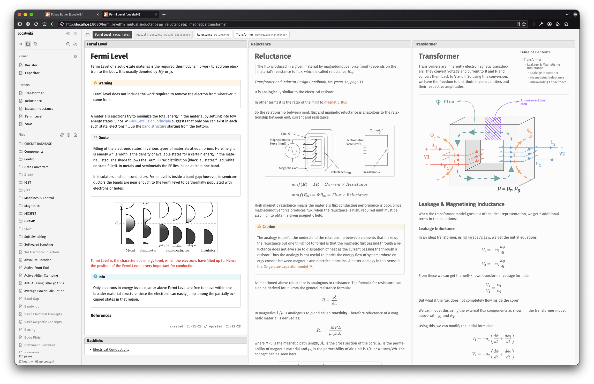
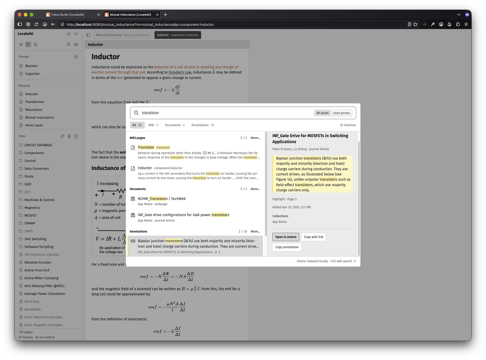
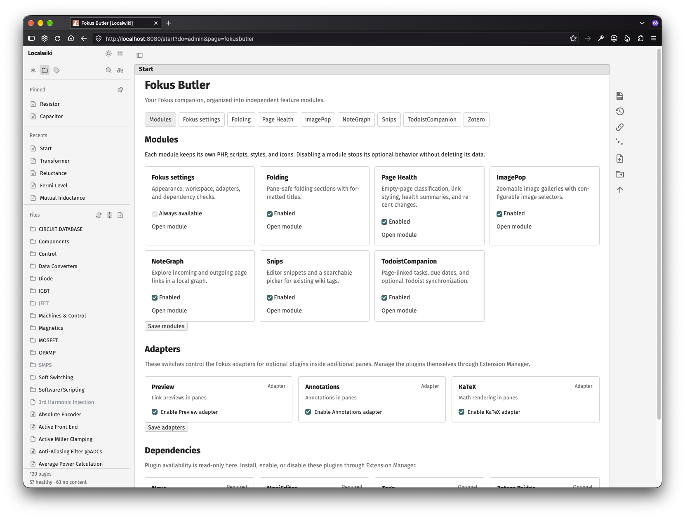

# Fokus

Fokus is a DokuWiki template built around an exploration-focused, multi-pane reading experience. It is derived from Simpl and the DokuWiki default template.

> For the full experience, consider installing my [Fokus Butler](https://github.com/kenandotfyi/fokusbutler) companion plugin.

As you might guess, this is a very opinionated template with a spesific look, although I think a lot of people would be happy about the aesthetics. 

I built this for turning the arguably simple default DokuWiki visual experience to a more personal wiki/PKM type of thing. I got inspired by many tools out there, one of them being Obsidian, which I have been using since its first day. One of the reasons I built this is to be able to access my notes and stuff no matter where in the world or which computer I am using, since closed source and desktop apps generally create problems in terms of IT restrictions for work environments. 

I wanted to have a unique look and also possibility to see multiple notes at the same time as well as being able to minimize them. This is coming from the gardening/zettelkasten principle and I have been inspired by Andy Matuschak's Notes website design. 

Links open to the right of the current page. Since DokuWiki has a solid AJAX implementation, I kept using it. The visual side and interactions are all vanilla JS.

Sidebar is toggleable and files section is implemented using the amazing library of [Trees](https://trees.software/) from [Pierre Computer](https://pierre.computer/), so it's not the default sidebar that DokuWiki offers as a convention not using a plugin. It scans and displays the pages in the DokuWiki installation.

There are quite some stuff going on there like the pinned and recently opened pages, traditional file manager with refresh and some right click operations such as rename, delete or add new. Tags section also shows the tags in the DokuWiki using the [Tag](https://www.dokuwiki.org/plugin:tag) plugin. 

Search bar is implemented again with AJAX and returns the results immediately in the pop overlay. It also shows the Zotero results if you installed and enabled my [Zotero Bridge](https://github.com/kenandotfyi/zoterobridge) plugin.

It has light/dark mode toggle, which I am not very happy with the dark mode colors currently. But at least night time reading is kind of covered. 

Fokus has many additional stuff built-in like: 
- ImagePop for creating basic image lightbox on the page
- Folding for foldable section creation
- Page Health for styling no-content pages differently and showing a status in the sidebar
- Snips for snippet support. 
- Todoist Companion for synchronizing tasks (currently one way DokuWiki -> Todoist) with Todoist.
- NoteGraph for creating local graphs with max. 3 deptsh for current page.

it also has adapters for existing plugins, since many of them would not work with multiple pane methodology otherwise:

- Annotations Adapter for multiple pane annotation support 
- KaTeX Adapter for displaying LaTeX formulas in every pane

and for better user experience, it has some plugin dependencies: 

- Move -> using Move plugin for page operations. I did not want to implement my own logic for that since it works already quite well
- MoaiEditor -> Bypassing the simple editor with Moai.
- Tags -> Tags support in the wiki and the sidebar
- Zotero Bridge -> Zotero integration support.

All of these integrations/dependencies, appearances and some styling options are all controlled by *Fokus Butler*, since templates can not create their own Admin pages.

Some screenshots below:

## Features

- Open linked wiki pages in side-by-side panes and scroll each pane independently.
- Minimize panes to a shelf in the header, restore them, or focus one pane.
- Keep pane state in the URL so the workspace can be refreshed or shared.
- One visible pane fills the workspace; two share it equally with the configured gap. Three or more visible panes retain fixed-width horizontal sliding. Sidebar space, outer margins, the workspace header, and the bottom status bar remain available.
- Zoom expands a pane inside the workspace and minimizes its peers to the shelf without changing their order. Toggle Zoom again to restore the prior layout, or restore a shelf pane to form a fitted pair while the remaining panes stay minimized. Opening a new pane while zoomed also forms a pair. Zoom survives reload through `z=<page-id>`; existing focus and minimized states remain independent. Revision and preview popups keep their modal layout.
- Switch between light and dark themes.
- Browse pages in a resizable Files sidebar powered by Pierre Trees, or switch to Tags to browse the Tag plugin's indexed tags and their pages.
- Filter the file tree and keep frequently used pages in a Pinned section.
- Use the DokuWiki edit popup, page revisions, and other page actions from pane headers.
- Normal link clicks replace the current pane and update its URL state. Shift-click adds a pane on the right. A destination already open in the workspace is focused instead of duplicated. Sidebar links retain their existing append behavior. Wiki and Wikipedia panes follow the same navigation rules, with neighboring panes preserved.
- Select page text to search it using the icon actions beside Annotate: the Phosphor magnifying glass opens the wiki search popup with the Wiki filter, and the Wikipedia icon opens search results in a workspace pane. Wikipedia pane selections offer the search actions without annotations and use the article's language edition. Search results use `wpsearch.en.Fermi_level` IDs and support refining the query. Normal result clicks replace the search pane with the article; Shift-click opens an additional pane. They restore on reload and stay separate from recent articles.
- Optionally initialize Preview, annotations, and KaTeX integrations in panes.

<h3>Installation and Development </h3>

## Installation

Place this directory at `lib/tpl/fokus` in a DokuWiki installation, then select **Fokus** as the template in DokuWiki’s Configuration Manager.

### Required dependency

Install and enable the [Move plugin](https://www.dokuwiki.org/plugin:move) through DokuWiki's Extension Manager. Fokus declares Move in `dependencies.json` and checks its required components at runtime. If Move is missing, disabled, or incomplete, Rename is disabled and administrators see an Extension Manager link. Page creation and deletion remain available through core DokuWiki.

For automatic dependency installation, Fokus's official DokuWiki catalog entry must declare `depends: move` in its repository metadata. The Extension Manager installs catalog dependencies before installing the template. This catalog entry is maintained separately from this repository; `dependencies.json` is Fokus's own runtime manifest and is not read by Extension Manager. Manual ZIP or Git installations require installing Move separately.

Do not add `depends move` to `template.info.txt`: the currently supported Extension Manager reads local info values as strings, while its dependency installer and dependant checks expect arrays. The catalog supplies the correct array type. Verify a fresh catalog installation before publishing a release.

## Configuration

Settings are available in the Configuration Manager under the Fokus template settings:

| Setting | Default | Description |
| --- | --- | --- |
| `panes_enabled` | `1` | Enable multi-pane exploration on wiki pages. |
| `pane_width` | `45` | Pane width in rem; allowed range is 25–100. |
| `dark_mode` | `1` | Enable the light/dark theme switch. |
| `sidebar_enabled` | `1` | Enable the Files and Tags sidebar. |
| `sidebar_hide_regex` | empty | Hide matching page IDs and namespace trees from the file explorer. |
| `adapter_annotations` | `0` | Enable the annotations plugin adapter for panes. |
| `adapter_katex` | `0` | Enable KaTeX rendering in panes. |

Each adapter also requires its corresponding plugin or rendering library to be installed and available.

## Sidebar

The file explorer lists readable, non-hidden wiki pages using their first heading as the display name, with a readable page basename as fallback. Pinned shortcuts use the same labels. Namespace folders use their matching namespace page (for example `component:capacitor` for `component:capacitor:*`), with a namespace start page as fallback. The associated page supplies the heading and is merged into the namespace row. Clicking its name or pressing Enter opens that page without changing expansion; clicking the folder icon or using Left/Right arrows controls expansion. Namespaces without an associated page expand or collapse on a name click. Namespace basenames are used when no heading is available. Page IDs and file paths remain unchanged; hovering a tree label shows its path. It does not depend on Indexmenu. File activation opens or focuses a Fokus pane; Ctrl/Cmd-click opens a new browser tab. File selection, folder expansion, and tree scroll stay independent of the active pane. Arrow keys navigate the tree and Enter opens a file. The Tags view uses the Tag plugin's index, excludes tags without visible pages, and loads each tag's pages on expansion. Clicking a tag in a pane opens and expands that tag in the sidebar, opening the sidebar first if it was collapsed. Refresh buttons reload the current index data. The asterisk Home link beside the Files icon navigates to the `start` page.

The Configuration Manager option `sidebar_hide_regex` hides matching page IDs and namespaces from the file explorer, including descendants of matching namespaces. Enter a case-insensitive regex without delimiters; for example `^(?:playground|wiki)(?::|$)` hides both root namespaces and their pages. Use `|` to combine rules, or leave the option blank to show all readable pages. Configuration Manager rejects invalid expressions. This is a display preference; Pinned, Tags, page access, and permissions are unaffected.

The sidebar's top row shows the wiki name and a dots-six menu with user and site actions. The dropdown omits the redundant wiki home link and DokuWiki's built-in action icons. Sidebar icon controls use 24px boxes with 4px corners. The header retains the sidebar toggle using Phosphor's sidebar duotone icon; the bottom row only shows the page count. Pages without the sidebar keep the header's VAULT menu as a fallback.

The binoculars button at the right of the navigation row opens a filter field that expands to its left. It switches to Files and focuses the field. Filtering ignores case and matches page headings, namespace headings, and original paths, revealing matching files inside namespaces. Closing the filter clears it and restores the navigation buttons and previous folder expansion. Escape clears a nonempty filter, then closes an empty one. Pinned shortcuts remain visible during filtering. Unified search opens with Ctrl/Cmd+Shift+F or the magnifying-glass button in the sidebar. It searches wiki titles and content alongside the local Zotero index.

Use the pin icon in the Pinned heading to pin or unpin the active page, or choose Pin/Unpin from a file's right-click menu. Each pinned row also has an unpin button, visible on hover or keyboard focus. Pins resolve against the current user's readable page list. The Files heading includes a Phosphor duotone file-plus button. It asks for a page name (including an optional namespace), then opens the existing editor popup through DokuWiki's core `do=edit` action. Core normalizes names, checks creation permissions, applies namespace templates, and saves the page. Existing names are rejected. After saving, the file list refreshes and the created page opens in a pane; closing without saving creates no file. Without pane support, creation opens the normal editor page. Files and Tags use accessible, compact icon-only Phosphor duotone tabs with 4px corner radii. File rows and pinned shortcuts use file-text duotone icons; refresh actions use arrows-clockwise duotone. Namespace expand controls use Phosphor folder duotone when collapsed and folder-open duotone when expanded. Tree row hover and selection backgrounds have 4px corners; selected backgrounds and focus borders use the page header colors. Without the Tag plugin the Tags view explains how to enable it.

Right-click a file or namespace for Rename and Delete. On a merged namespace row, right-click the name for its associated page actions (including Pin/Unpin), or the folder icon for namespace actions. Keyboard Shift+F10 uses page actions when an associated page exists. Namespace rows and their matching landing pages offer New page here as the first menu item, which reuses the creation dialog with the namespace prefilled. File links in Pinned and Tags support the same menu. Shift+F10 opens it from the keyboard; arrows navigate and Escape dismisses it. Rename uses the installed Move plugin to preserve page history and rewrite links. A namespace rename includes its descendant pages; media files retain their current namespace. Delete uses core page saving, retains revision history, and confirms the affected page count before acting. Namespace deletion includes descendant pages and keeps media files. All affected pages must pass permissions and lock checks; changed pages require a fresh confirmation. Pinned IDs and open-pane URLs follow renames, while deleted pages are removed from pins and the workspace. The workspace reloads after successful mutations to refresh links and content.

Pins are stored on the server in `<DokuWiki cachedir>/pinned/user-<SHA-256 of username>.json` (normally `data/cache/pinned`). Each signed-in user has their own list, shared across browsers and devices. Wikis with ACLs disabled use `shared.json` for unsigned visitors; with ACLs enabled, visitors must sign in to pin. Lists contain only page IDs, and every response filters missing, hidden, or unreadable pages. Incremental pin/unpin writes are locked and atomic. Pins reload on focus, visibility changes, and file refresh. Fokus renames and deletions update all users' stored references. Include this folder in backups and preserve it when clearing caches: these JSON files are saved preferences, not disposable generated cache.

When Page Health is enabled, the file explorer footer adds healthy and no-content counts for the pages included in the explorer, respecting sidebar exclusions and the current filter. Counts include associated namespace pages once, even though their duplicate file rows are merged. File and associated namespace labels, plus pinned shortcuts, use Page Health's configured color, hover color, opacity, italics, and decoration. Fokus calls the plugin's existing ACL-checked classification endpoint in batches of up to 500 and inherits its CSS variables into the tree's shadow DOM; no plugin changes or full scan are required. Refresh files reloads classifications. Failed or missing classifications are counted as unchecked, never healthy; without Page Health the footer keeps the regular page count.

The sidebar remembers only its width, selected view, and expanded folders in browser-local storage scoped to the wiki and signed-in user. It starts collapsed on small screens. Use the header toggle to restore it. The resize separator also supports Left/Right arrows and Home/End. The sidebar is omitted from the pane editor popup and from printed output.

Sidebar source and its pinned dependencies live in `sidebar/`. The committed `sidebar.bundle.js` is self-contained and served locally; Node.js and external CDNs are not required on the wiki server. To rebuild after changing `sidebar/sidebar.js`, run `pnpm install --frozen-lockfile` and `pnpm run build` in that directory. PHP and CSS changes do not need a JavaScript rebuild. Navigation JSON is served through the initialized template with `fokus_nav=files`, `tags`, `tag`, `pins` (GET/POST pin storage), `newpage` (name resolution), or `target` (action preflight); responses are private and are not cached. File mutations use `fokus_nav=action` with POST, a core session token, and a preflight fingerprint.

## Licenses

Fokus is licensed under the MIT License; see [LICENSE](LICENSE). Phosphor icon assets are covered by [PHOSPHOR-LICENSE.txt](PHOSPHOR-LICENSE.txt).

The sidebar bundles `@pierre/trees` 1.0.0-beta.6 (Apache-2.0), Preact, `preact-render-to-string`, and Pierre's theming utilities. Their licenses and the Trees attribution notice are preserved in `sidebar/licenses/`.

## Fokus Settings companion

The `fokusbutler` companion adds **Admin → Fokus Butler**, also linked from the wiki actions menu for administrators. Its **Fokus settings** module provides Appearance and Workspace sections. The **Modules** page includes separate Adapters and Dependencies sections. Move supports renaming with link updates, and MoaiEditor powers editing in the pane popup. Install the companion under `lib/plugins/fokusbutler` alongside the Fokus template. No live theme preview is included.

Appearance includes separate optional light/dark color overrides (text, muted text, backgrounds, borders, accent, internal/external links and hover colors, missing page links, and search-match highlights), bundled/system font choices, heading font, text size and line height, pane padding, workspace gutter, pane gap, paragraph spacing, page/dialog corners, control/tree corners, search popup width and result height, and link decoration and weight. The search popup inherits the shared theme colors, typography, and corner radius. Search-match highlight colors apply in the popup and opened panes. Missing page links default to red with a dotted underline and can be styled independently of existing internal links. Tag plugin links (`rel="tag"`) have their own light/dark colors, hover colors, decoration, and weight. Blank colors retain template defaults. Page Health retains its semantic no-content styling for actual wiki pages. Restore defaults applies only to the selected section, preserving protected values.

The template owns all settings in `$conf['tpl']['fokus']`, defined by `settings-schema.php`; the standard Configuration Manager remains usable. The companion validates every submitted field before saving through DokuWiki's Configuration API, requires administrator access and a core security token, and respects protected settings. Settings continue to render through `appearance.php` when the companion is disabled. Reload existing wiki tabs after saving.

### Interwiki appearance

Appearance → Interwiki links discovers prefixes through DokuWiki's merged built-in/local interwiki definitions, including entries such as `zotero` and `wp`. Select a prefix to set separate light/dark text, hover text, background, and hover background colors, plus decoration, decoration style, font weight/style, and favicon visibility. Blank values use prefix defaults before falling back to existing stylesheet rules. Zotero's former stylesheet palette is now defined in the shared settings defaults: red text in both themes, with separate light/dark hover text and backgrounds. The controls display these defaults. Clear a value to restore its default; DokuWiki continues to supply favicons. Prefix destinations remain managed by DokuWiki.

Overrides are stored as the template's `interwiki_styles` JSON setting and work without the companion plugin. One serialized value preserves changes across multiple prefixes without hitting PHP's form-variable limit. The server validates prefixes, field names, hex colors, and allowed style values before saving or generating CSS. CSS class names use DokuWiki's renderer normalization (for example `amazon.de` becomes `iw_amazon_de`). Both existing and dynamically loaded pane links receive the styles. This discovers configured prefixes rather than performing a full wiki content scan.

### Shared appearance values

Fokus's active screen styles use CSS variables supplied by the shared `settings-schema.php` defaults and saved template configuration. Palette fields show their real defaults. Empty color values resolve to those defaults. Accent backgrounds, text on accents, input colors, and generic interwiki links have dedicated controls; code/page-ID fonts and sidebar text size are configurable too.

Component color roles preserve existing neutral light/dark shades by default and inherit their source setting when that setting is customized. This covers pages, panes, sidebar, dialogs, editors, admin views, tables, media views, and links. Page Health and semantic integration-status colors retain their own styling. Print keeps its paper-oriented styles. Standard `style.ini` color replacements remain for DokuWiki/plugin compatibility; use Fokus Settings for Fokus appearance.

The template bundles pane/sidebar styles through DokuWiki's CSS pipeline. `appearance.php` emits validated variables and interwiki rules, rather than selector-specific color overrides. The generated `css/theme-defaults.css` supplies the same default variables for exports and before runtime overrides load. After changing schema defaults, regenerate it with `php lib/tpl/fokus/bin/build-appearance.php` from the wiki root. Configuration changes need no rebuild.

## Fokus Butler companion

Install the `fokusbutler` plugin alongside this template. It supplies the unified admin page and separate modules for settings, folding, Page Health, ImagePop, NoteGraph, Snips, and TodoistCompanion. Open **Fokus Butler** from the sidebar wiki-actions menu, then use **Modules** to control features or **Fokus settings** for appearance and workspace controls. Each feature keeps its own scripts and stylesheet inside the companion.

The standalone fokussettings, fokusfold, pagehealth, imagepop, notegraph, snips, and todoistcompanion plugins are replaced by the companion and should not be enabled alongside it. Move, Tag, and optional adapter plugins remain external dependencies. Template pins and recents remain template-owned. The sidebar keeps separate per-user histories for the last ten wiki pages and the last ten content-provider pages. Recent Wikipedia appears below Recents, saves article titles after successful pane loads, and reopens entries through the provider registry. Both recent sections support page previews. Hover previews do not enter this history.

## Workspace status

The full-width workspace status bar stays fixed at the bottom in a single 24 px row. It shows readable page totals, cached Page Health coverage, combined task totals/open tasks from readable wiki pages and the connected Todoist project, deduplicated by Todoist ID, and local Zotero sync status when the corresponding modules and permissions are available. Hover an item for details, including completed tasks and Zotero's last successful check and index counts. Totals do not follow sidebar filters. The bar refreshes every minute, reusing Todoist’s cached project/completion refresh and reading local Zotero state (every five seconds during an active Zotero job), pauses polling in background tabs, and refreshes after pane saves and task completion; automatic polling never starts a Zotero sync or a Page Health scan. The arrows-clockwise button starts an incremental Zotero sync and shows “Syncing…” with progress while running. A subtle green cloud-check marks success and a subtle red cloud-slash marks failure; the last successful sync time stays visible, and the button becomes available again after the run. Editor popup frames omit the bar. Its PHP/JS checks are in `statusbar/tests/`.

## Unified search

The popup offers All, Wiki, Documents, Annotations, and Wikipedia filters, grouped results, counts, previews, and more-results controls. All starts with two results per local source. Wikipedia searches English Wikipedia only when its own filter is selected, after a 450 ms typing pause; it uses the Butler content module's cached endpoint and returns up to 20 results. It is excluded from All and its counts. Wikipedia results open as workspace panes, or offer `[[wp>Article_title|Article title]]` insertion in the native and CodeMirror editors. Arrow keys select a result, Enter opens it (or inserts in edit mode), Tab reaches actions, and Escape closes. Shift+Enter or Full wiki search opens DokuWiki's full search page. The local-source match control offers All words (AND search) or Exact phrase; Wikipedia uses its own ranking. Wiki results retain page ACL and hidden-page checks.

With Zotero Bridge configured, administrators can search document metadata, collections, tags, annotation text, and comments. Choose a PDF when a document has several; metadata-only records open Zotero's item selection. Copy wiki link uses the existing `[[zotero>...|...]]` syntax. In the native editor and Moai pane popup, Search & insert preserves the cursor/selection and offers quoted annotations, optional comments, or links alone. Annotation quotes are escaped as literal wiki text wrapped in the Zotero highlight color using the Color plugin (black text with the highlight color as background), and followed by ` -> ` and the Zotero link on the same line. Physical PDF page numbers drive deep links; printed labels remain visible.

Search reads the local index and refreshes after a published index generation changes. It polls local status while open; automatic remote synchronization is still a separate, pending worker feature.

The vanilla dialog needs no React runtime or CDN. Sources live in `search/`: `provider.php` supplies private ACL-filtered wiki JSON through `fokus_search=1`; `zotero.js` adapts the standalone plugin; `format.js` and `palette.js` handle insertion and UI. After JavaScript/CSS edits, run `php lib/tpl/fokus/bin/build-search.php` to regenerate content-hashed assets and the manifest. `search/tests/format.cjs` checks reference formatting; `search/tests/wiki.php` requires an isolated `zoterobridge-runtime` DokuWiki installation and checks ACLs and rendered quote safety.

